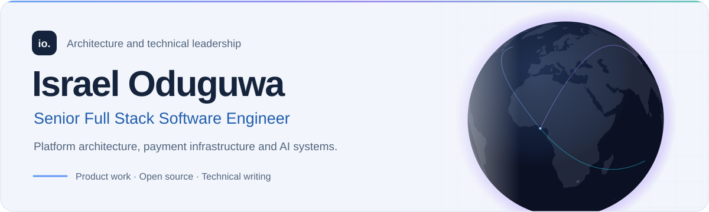

<picture>
  <source media="(prefers-color-scheme: dark)" srcset="./.github/profile/header-dark.svg">
  <source media="(prefers-color-scheme: light)" srcset="./.github/profile/header-light.svg">
  
</picture>

 

I'm Israel, a senior full-stack software engineer. I build web applications and the services behind them. I've worked on healthcare hiring, student enrollment and payment recovery, and reviewed generated code on an AI evaluation project.

Most of my application work uses React, Next.js and Node.js, with Python for data and recommendation services. At KinsCare, I guided a seven-developer team through frontend modernization and an identity migration. At Excel Health Careers, I connected registration, Stripe payments and student records.

I also maintain [SafeStripe](https://github.com/Israel-oduguwa/SafeStripe), a TypeScript library for recovering Stripe workflows after timeouts, repeated webhooks and worker crashes.

[Portfolio](https://israel-oduguwa.vercel.app/) &nbsp; · &nbsp; [Résumé](https://israel-oduguwa.vercel.app/documents/israel-oduguwa-resume.pdf) &nbsp; · &nbsp; [Email](mailto:oduguwa.israel22@gmail.com)

 

## My works
### SafeStripe

Payment recovery for Node.js, Express and Next.js.

A Stripe request can succeed while your application loses the response. Webhooks can repeat, and a worker can crash after claiming a job. SafeStripe stores operation history and accepted work in your database so recovery can continue the original workflow.

I built the library, database adapters, framework integrations and failure tests. The public sandbox lets you inspect recovery behavior, and the documentation explains retry boundaries and worker ownership. Version 0.3.0 is an evaluation preview with reproducible benchmarks.

[Source](https://github.com/Israel-oduguwa/SafeStripe) &nbsp; · &nbsp; [Documentation](https://israel-oduguwa.github.io/SafeStripe/) &nbsp; · &nbsp; [Try the sandbox](https://safestripe-demo.vercel.app/) &nbsp; · &nbsp; [Benchmarks](https://israel-oduguwa.github.io/SafeStripe/benchmarks/)

<table>
  <tr>
    <td width="50%" valign="top">
      <h3>KinsCare</h3>
      
A healthcare hiring marketplace connecting caregivers with care providers.

      
I guided a seven-developer team, migrated the frontend to Next.js, and worked on identity migration, matching services and infrastructure costs.

      
Next.js · Node.js · Python · MongoDB · Clerk

      
<a href="https://israel-oduguwa.vercel.app/work/kinscare">Case study</a> · <a href="https://www.kinscare.org/">Live product</a>

    </td>
    <td width="50%" valign="top">
      <h3>Excel Health Careers</h3>
      
Enrollment and payment workflows for a healthcare training business.

      
I connected registration, Stripe events and administrative records, and built acquisition and video-generation workflows with recovery paths.

      
Next.js · Stripe · Firebase · Remotion · AWS

      
<a href="https://israel-oduguwa.vercel.app/work/excelcna">Case study</a> · <a href="https://www.excelcna.com/">Live product</a>

    </td>
  </tr>
</table>

## AI evaluation

On a one-month software engineering project with micro1, I designed frontend evaluation tasks from supplied source material, wrote reference solutions and defined criteria for reviewing the results. I checked generated implementations for correctness, completeness, source use, security and maintainability.

I use the same approach in application work: follow a request through the frontend, API and database, find the failing layer, and check the proposed fix against it.

## Tools I use

| Area | Tools and work |
| --- | --- |
| Product interfaces | TypeScript, JavaScript, React, Next.js, responsive CSS, accessibility |
| Services and data | Node.js, Express, Python, PostgreSQL, MongoDB, Firebase |
| Payments and operations | Stripe, webhook processing, recovery workflows, AWS, CI |
| Applied AI | OpenAI APIs, LangChain, agent integrations, evaluation tasks and rubrics |

## Technical writing

- [Stripe idempotency does not finish the payment workflow](https://israel-oduguwa.vercel.app/articles/stripe-idempotency-your-app-still-needs-it): where request retries, webhook deduplication and business effects meet.
- [What a crashed payment worker leaves behind](https://israel-oduguwa.vercel.app/articles/worker-ownership-and-payment-recovery): leases, ownership checks and the transaction boundary behind recovery.

[More articles](https://israel-oduguwa.vercel.app/articles)

## Background

I started programming in 2015 through an interest in mobile games, then explored Scratch and Python before moving into web development. My work since then has included building products, guiding engineering teams, teaching and AI evaluation.

Recent study includes [Building AI Agents with OpenAI](https://coursera.org/verify/specialization/J6PYEOZO0PN5) and [Generative AI for NodeJS: OpenAI, LangChain, TypeScript](https://www.udemy.com/certificate/UC-3eb8e8b7-669e-42de-bb6a-cc4766816210/).

---

I'm open to full-stack engineering roles, software engineering evaluation work and contract projects.

[View my portfolio](https://israel-oduguwa.vercel.app/) &nbsp; · &nbsp; [Email me](mailto:oduguwa.israel22@gmail.com)

  
Portfolio development

  
This repository also contains the portfolio website. The <a href="./docs/portfolio-development.md">development guide</a> covers local setup, checks and deployment.

