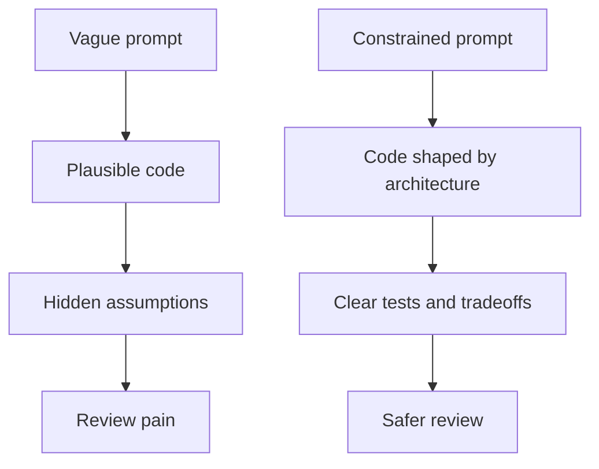
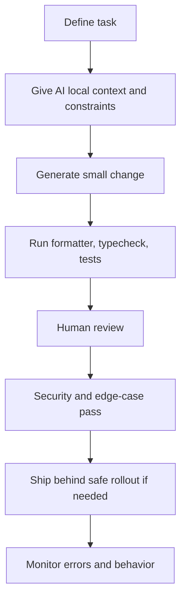

# AI-Written Code Is Easy to Generate. Making It Production-Safe Is the Hard Part.


*AI coding tools can move fast. The senior work is making sure that speed does not quietly become security risk, test debt, and messy architecture. Photo by Igor Omilaev on [Unsplash](https://unsplash.com/photos/laptop-displays-the-ai-code-editor-website-wjFOjA2zXy8).*

AI has changed the feeling of programming.

A feature that used to start with a blank file can now start with a prompt. A bug fix can begin with an agent reading the stack trace. A migration script can be drafted in seconds. A test file can appear before you finish explaining the edge case.

That is useful.

It is also dangerous if the team starts confusing generated code with finished code.

Tools like Codex, Claude, Cursor, Copilot, and other AI coding agents are good at producing plausible code quickly. But production software does not only need plausible code.

It needs code that fits the existing system.

It needs code that handles failure.

It needs code that respects permissions.

It needs code that can be reviewed, tested, deployed, rolled back, monitored, and maintained six months later by someone who did not write the prompt.

That is the hard part.

AI makes code generation cheaper.

It does not make engineering judgment optional.

In fact, it makes judgment more important.

## The New Problem Is Not "Can We Write Code Faster?"

Most teams can now write code faster.

That is not the interesting question anymore.

The better question is:

> Can we safely absorb more code into production without increasing bugs, security issues, and maintenance cost?

That question is harder.

Stack Overflow's 2025 developer survey summary said AI adoption is accelerating, but trust is declining. It reported that 84% of developers use or plan to use AI tools, while only 29% trusted AI outputs to be accurate.

That matches what many experienced engineers feel in practice.

AI is helpful.

AI is also frequently "almost right."

And almost-right code is expensive because it looks done before it has been understood.

## The Senior Risk: AI Increases Output Before It Increases Understanding

A junior developer may use AI and think:

> Great, it wrote the function.

A senior developer looks at the same output and asks:

> Does this match our architecture?
> Does this bypass permissions?
> Does this handle retries?
> Does this leak data?
> Does this introduce a dependency we do not need?
> Does this create a future migration problem?
> Does this pass because the test is weak?

The risk is not that AI writes bad code all the time.

The risk is that AI writes confident code faster than teams can review it.


This is why "we use AI now" is not a strategy.

A strategy needs guardrails.

## DORA's Warning: Speed Without Discipline Can Hurt Stability

Google's DORA research on generative AI in software development is worth taking seriously because it looks beyond individual productivity.

In its 2025 analysis, DORA reported that AI adoption improved several process measures but did not automatically improve software delivery performance. The report warned that AI can increase the amount of code produced, which can lead to larger changes. Larger changes are harder to review and more likely to create instability.

That is the practical lesson:

> AI does not remove the need for small batches. It makes small batches more important.

If an AI agent generates a 1,500-line pull request touching auth, billing, database queries, UI state, and tests, that is not a productivity win.

That is review debt.

A senior engineer should push the work into smaller slices:

```txt
PR 1: Add schema and migration
PR 2: Add backend service with tests
PR 3: Add API route and authorization checks
PR 4: Add UI states
PR 5: Add observability and cleanup
```

AI can help write each slice.

But the human should still control the shape of the change.

## The AI Code Review Rule: Assume It Is a Smart Intern, Not a Senior Engineer

This is the healthiest mental model I have found:

> Treat AI output like work from a fast junior developer who never gets tired, sounds confident, and has not lived with your codebase.

That is not an insult.

It is a review posture.

You do not merge a junior developer's code because it compiles.

You review:

- correctness
- assumptions
- security
- consistency with existing patterns
- tests
- edge cases
- readability
- future maintenance

Do the same with AI.

If the AI writes a function, ask it to explain the failure cases.

If it writes a migration, ask how rollback works.

If it writes an API route, ask where authorization is enforced.

If it writes a test, check whether the test can fail for the right reason.

The goal is not to distrust AI emotionally.

The goal is to verify it professionally.

## The Most Common AI Coding Failure Modes

After using AI tools in real development workflows, the same problems show up again and again.

### 1. It invents APIs that look real

AI often writes code against APIs that almost exist.

Example:

```ts
const user = await auth.getCurrentUserWithPermissions();
```

Maybe your auth library has `getCurrentUser`.

Maybe your permission system has `getPermissions`.

But this exact helper may not exist.

That kind of mistake is easy to catch when code fails immediately.

The more dangerous version is when the API exists but is used incorrectly.

```ts
await cache.set(key, value, 60);
```

Does `60` mean seconds? Milliseconds? Options object? TTL? Priority?

AI may not know.

You have to check.

### 2. It copies patterns from the internet instead of your codebase

AI has seen many ways to write code.

Your codebase probably has one preferred way.

If the app uses server actions, AI may create API routes.

If the app uses Zod validation, AI may hand-roll validation.

If the app uses a repository layer, AI may query Prisma directly from a component.

If the app uses a design system, AI may invent new CSS classes.

This is why context matters.

Before asking AI to implement something, give it the local pattern:

```txt
Use the existing invoice service style.
Follow the authorization pattern in src/lib/authz.ts.
Do not introduce a new validation library.
Add tests beside the current service tests.
Keep the PR under 300 lines if possible.
```

Good prompting is not magic language.

It is architecture guidance.

### 3. It handles the happy path and forgets production behavior

AI is very good at making the first demo work.

It may forget:

- loading states
- empty states
- permission checks
- duplicate submissions
- retries
- rate limits
- audit logs
- cleanup jobs
- idempotency
- partial failures
- observability

Example:

```ts
await sendInviteEmail(email);
await db.invitation.create({ data: { email, organizationId } });
```

This looks fine until the email sends and the database write fails.

Now the user receives an invite that the app does not recognize.

Senior review asks:

> What happens if step two fails after step one succeeds?

AI will not always ask that unless you force it to.

### 4. It creates security-shaped code without real security

AI may write code that looks secure:

```ts
if (!user) {
  throw new Error("Unauthorized");
}
```

But authentication is not authorization.

The route may still expose another customer's data:

```ts
const invoice = await db.invoice.findUnique({
  where: { id: invoiceId },
});
```

The safer version scopes by organization:

```ts
const invoice = await db.invoice.findFirst({
  where: {
    id: invoiceId,
    organizationId: user.organizationId,
  },
});
```

AI can easily miss this if the prompt says:

> Build an invoice endpoint.

Instead, ask:

> Build an invoice endpoint that follows our tenant-scoped authorization pattern and includes a test proving users cannot access invoices from another organization.

That one sentence changes the output.

### 5. It writes tests that prove the code runs, not that the behavior is correct

AI-generated tests often test the obvious.

```ts
it("returns invoices", async () => {
  const result = await listInvoices(user);
  expect(result).toBeDefined();
});
```

This test is weak.

A better test checks the dangerous boundary:

```ts
it("does not return invoices from another organization", async () => {
  const orgA = await createOrganization();
  const orgB = await createOrganization();
  const userA = await createUser({ organizationId: orgA.id });
  await createInvoice({ organizationId: orgB.id });

  const result = await listInvoices(userA);

  expect(result).toHaveLength(0);
});
```

The difference is seniority.

Weak tests ask:

> Did something come back?

Strong tests ask:

> Did the system protect the boundary that matters?

## Prompting Is Part of Engineering Now

Bad prompt:

```txt
Add billing.
```

Better prompt:

```txt
Add a billing settings page using the existing settings layout.
Use the current server action pattern.
Only organization owners can update billing.
Add loading, empty, and error states.
Do not call Stripe from the client.
Add tests for non-owner access and missing organization.
Keep the changes small and explain any tradeoffs.
```

A senior developer does not prompt for "code."

A senior developer prompts for constraints.

The constraints are the engineering.



The model can generate.

The engineer must frame the problem.

## Use AI Differently at Each Stage

AI is not equally useful for every part of the work.

Here is how I would use it in a production team.

### 1. Planning

Good use:

```txt
Read these files and propose a minimal implementation plan.
List the files that probably need changes.
Call out risks around auth, data migration, performance, and rollback.
Do not edit code yet.
```

Why this works:

AI is good at scanning and summarizing.

But the human should approve the plan before the agent edits core logic.

### 2. Implementation

Good use:

```txt
Implement only the service-layer function and its tests.
Do not touch UI files.
Follow the existing error handling style.
```

Why this works:

Bounded tasks are easier to review.

AI agents are less likely to wander when the ownership boundary is clear.

### 3. Testing

Good use:

```txt
Generate edge-case tests for this function.
Focus on permissions, empty data, invalid input, and retries.
Do not change production code.
```

Why this works:

AI is useful for brainstorming cases humans may miss.

But you still need to inspect whether the tests assert meaningful behavior.

### 4. Review

Good use:

```txt
Review this diff like a senior backend engineer.
Look for data leaks, race conditions, missing authorization, weak tests, and unnecessary abstraction.
```

Why this works:

AI can be a second reviewer.

It should not be the only reviewer.

### 5. Refactoring

Good use:

```txt
Refactor this function without changing behavior.
Keep public APIs the same.
Run tests after the change.
Show the diff summary.
```

Why this works:

Refactoring is safer when the behavior is pinned by tests.

Without tests, AI refactors can silently change meaning.

## The Production-Safe AI Workflow

If I were setting up AI-assisted development for a team, I would use this workflow.



The important part is that AI is inside the workflow.

It is not the workflow.

## A Practical AI Code Review Checklist

When reviewing AI-generated code, I would ask:

- Does this follow existing project patterns?
- Did it introduce a new dependency without a strong reason?
- Are permissions checked on the server?
- Are tenant or organization boundaries enforced?
- Does it trust frontend input?
- Does it handle missing, empty, invalid, and duplicate input?
- What happens if an external service fails?
- Are retries safe?
- Are database writes atomic where they need to be?
- Are tests meaningful or just snapshot/coverage filler?
- Does the code log enough context to debug?
- Does it expose secrets or sensitive data?
- Is the change small enough to review properly?
- Can we roll it back?

This is the kind of checklist that turns AI from a risky shortcut into a useful engineering tool.

## Security: AI Can Help You Write Vulnerabilities Faster

OWASP's Top 10 for Large Language Model Applications includes risks such as prompt injection and insecure output handling.

Those risks matter when you are building AI features.

But even when AI is only helping you write normal application code, security still matters.

AI may produce:

- SQL queries without proper scoping
- API routes without authorization
- server actions that trust client input
- logging that exposes secrets
- dependencies with unclear maintenance
- file upload handling without validation
- webhook handlers without signature verification
- admin tools without audit logging

Example:

```ts
export async function POST(req: Request) {
  const body = await req.json();

  await db.user.update({
    where: { id: body.userId },
    data: { role: body.role },
  });
}
```

This is the kind of code that looks simple and ships a serious bug.

Who is making the request?

Are they allowed to change roles?

Can they make themselves an owner?

Does the target user belong to the same organization?

Is the role valid?

Is the action audited?

A safer version starts with the security model:

```ts
export async function POST(req: Request) {
  const actor = await requireUser(req);
  const body = updateRoleSchema.parse(await req.json());

  const targetUser = await db.user.findFirst({
    where: {
      id: body.userId,
      organizationId: actor.organizationId,
    },
  });

  if (!targetUser) {
    return new Response("Not found", { status: 404 });
  }

  await authorize(actor, "user:update_role", targetUser);

  await db.user.update({
    where: { id: targetUser.id },
    data: { role: body.role },
  });

  await auditLog.create({
    actorId: actor.id,
    action: "user:update_role",
    targetUserId: targetUser.id,
  });
}
```

AI can write either version.

Your standards decide which one gets merged.

## The "Almost Right" Problem

The most dangerous AI code is not obviously wrong.

Obviously wrong code fails fast.

Almost-right code passes casual review.

Examples:

```txt
The code checks login but not ownership.
The cache key misses organizationId.
The webhook verifies the event type but not the signature.
The migration works forward but has no rollback plan.
The test mocks the function so heavily that it proves nothing.
The UI handles success but fails silently on error.
The query works for 10 rows but not 100,000.
```

This is why senior developers are still valuable in an AI-heavy workflow.

They know where bugs hide.

They know which details become incidents later.

They know that a feature is not done just because the demo works.

## How Junior Developers Should Use AI Without Getting Weaker

AI can help juniors learn faster.

It can also make them dependent if they skip understanding.

A healthy rule:

> Never merge code you cannot explain.

If AI writes a function, ask:

```txt
Explain this code line by line.
What assumptions does it make?
What can fail?
What test cases should exist?
How would this behave with bad input?
How would this behave with no data?
How would this behave with 10,000 records?
```

Then verify the answer.

Do not use AI only to avoid thinking.

Use it to expose what you need to think about.

## How Senior Developers Should Use AI Without Lowering Standards

Senior developers should not pretend AI is useless.

That is not serious.

AI is useful for:

- reading unfamiliar code
- generating first drafts
- producing test ideas
- writing boilerplate
- comparing implementation options
- summarizing logs
- spotting obvious bugs
- refactoring with constraints
- documenting decisions

But senior developers should also raise the bar around:

- smaller PRs
- stronger tests
- clearer architecture boundaries
- security review
- rollout safety
- code ownership
- documentation of tradeoffs

The senior job is not to type every line manually.

The senior job is to make sure the system remains understandable and safe as code volume increases.

## A Team Policy That Actually Works

You do not need a 30-page AI policy.

You need clear working rules.

Example:

```txt
1. AI-generated code must be reviewed like human code.
2. No generated code is merged without tests for meaningful behavior.
3. Security-sensitive changes require human review from an owner.
4. AI cannot introduce new dependencies without approval.
5. Large AI-generated diffs must be split before review.
6. Secrets, customer data, and private keys must not be pasted into AI tools.
7. Generated code must follow existing project patterns.
8. The author must be able to explain the change.
```

That is enough to start.

The goal is not to slow everyone down.

The goal is to prevent AI speed from becoming production chaos.

## A Better Definition of Done for AI-Assisted Work

For AI-assisted code, "done" should mean:

- the code compiles
- the tests pass
- the author understands the code
- the change follows local patterns
- security boundaries are checked
- failure states are handled
- logs are useful
- the diff is reviewable
- rollback is possible
- the production risk is understood

That is a much higher bar than:

> The AI generated it and it seems to work.

## The Real Lesson

AI-written code is easy to generate.

Production-safe code is still hard.

That is not because AI is bad.

It is because production is unforgiving.

Real software has users, money, permissions, data boundaries, slow networks, retries, migrations, logs, support tickets, security reviews, and future maintainers.

AI can help with the typing.

It can help with the first draft.

It can help explore options.

It can help find mistakes.

But it cannot own the outcome.

The team owns the outcome.

That is the senior mindset:

> Use AI to move faster, but keep engineering discipline in charge.

The companies that win with AI will not be the ones that generate the most code.

They will be the ones that turn AI output into reliable software without losing control of quality.

## Sources

- [GitHub Octoverse 2025](https://github.blog/news-insights/octoverse/octoverse-a-new-developer-joins-github-every-second-as-ai-leads-typescript-to-1/)
- [Stack Overflow 2025 Developer Survey: AI adoption and trust](https://stackoverflow.co/internal/resources/2025-stack-overflow-developer-survey-for-leaders/ai-adoption/)
- [DORA: Impact of Generative AI in Software Development](https://dora.dev/ai/gen-ai-report/dora-impact-of-generative-ai-in-software-development.pdf)
- [OWASP Top 10 for Large Language Model Applications](https://owasp.org/www-project-top-10-for-large-language-model-applications/)
