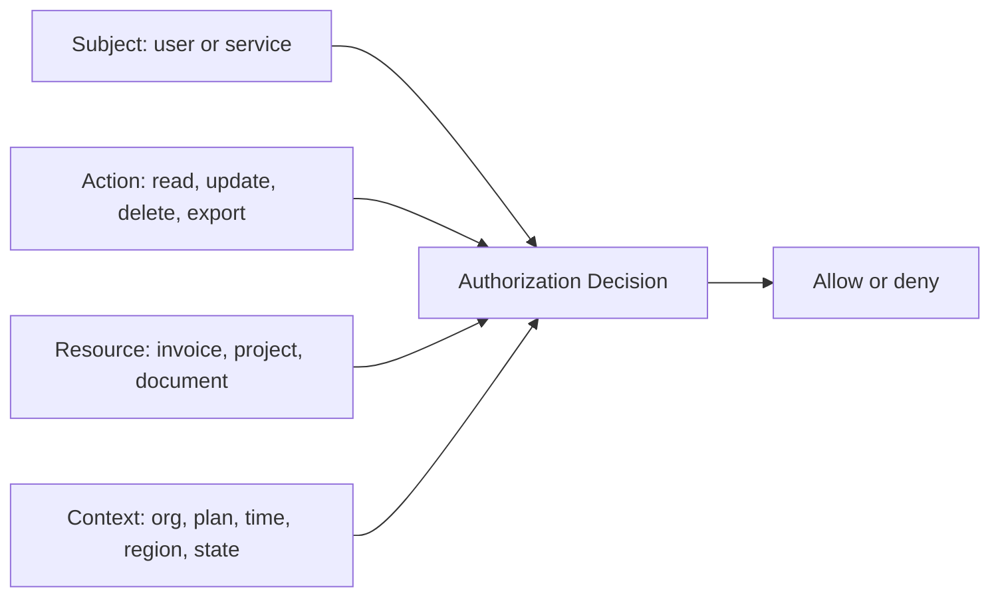
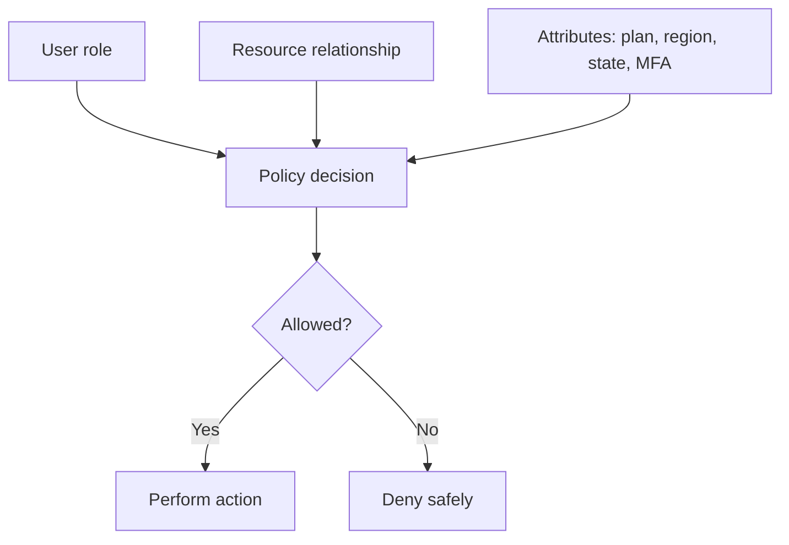

# Authorization Architecture Beyond Roles


*Roles are a useful start, but serious SaaS permissions need to understand users, resources, organizations, ownership, billing plans, and context.*

Most apps start with simple roles.

```txt
admin
member
viewer
```

At the beginning, this feels fine.

The admin can do everything. The member can do normal work. The viewer can only read.

Then the product grows.

A customer asks for project-level permissions. Another customer wants finance users to manage billing but not delete projects. The support team needs temporary access to debug accounts. Enterprise customers want audit logs. The sales team wants feature access tied to pricing plans. The product team wants beta features for only some workspaces.

Suddenly, `role === "admin"` is not an authorization architecture.

It is a shortcut that has started to leak into every part of the codebase.

This is where senior engineering judgment matters.

Authorization is not only about asking:

> Is this user an admin?

It is about asking:

> Can this specific user perform this specific action on this specific resource, in this specific context, right now?

That sounds longer because real authorization is longer.

And if the system is not designed well, the complexity still exists. It just hides inside scattered `if` statements.

## Authentication Is Not Authorization

Before going deeper, separate two ideas.

Authentication answers:

> Who are you?

Authorization answers:

> What are you allowed to do?

A logged-in user is authenticated.

That does not mean they can view every invoice, delete every workspace, invite every team member, or export every report.

This mistake shows up all the time:

```ts
if (!session.user) {
  return new Response("Unauthorized", { status: 401 });
}

const invoice = await db.invoice.findUnique({
  where: { id: invoiceId },
});

return Response.json(invoice);
```

The code checks if the user is logged in.

It does not check whether the invoice belongs to the user's organization or whether the user is allowed to view billing.

A better version starts to ask ownership and permission questions:

```ts
const invoice = await db.invoice.findFirst({
  where: {
    id: invoiceId,
    organizationId: session.user.organizationId,
  },
});

if (!invoice) {
  return new Response("Not found", { status: 404 });
}

if (!can(session.user, "invoice:read", invoice)) {
  return new Response("Forbidden", { status: 403 });
}

return Response.json(invoice);
```

That difference matters.

Authentication gets the user through the door.

Authorization decides which rooms they can enter.

## Why Basic Roles Break Down

Basic roles work when the product is small and the rules are simple.

They break when permissions become specific.

Imagine a SaaS project management app.

At first:

```txt
owner can do everything
admin can manage projects
member can work on tasks
viewer can read only
```

Then customers ask for real-world rules:

- A contractor can view only one project.
- A finance manager can view invoices but cannot edit product settings.
- A team lead can invite users to their team but not the whole organization.
- A support engineer can access a workspace for 30 minutes after approval.
- A user can edit a document they created, unless it has been locked.
- A customer on the free plan cannot use advanced audit exports.
- A user can view a report only if it belongs to their region.
- An enterprise workspace can require SSO before admin actions.

If you keep forcing these into `admin`, `member`, and `viewer`, the code starts to rot.

You get logic like this:

```ts
if (
  user.role === "admin" ||
  user.role === "owner" ||
  (user.role === "member" && project.createdById === user.id) ||
  (user.flags.includes("beta_reports") && organization.plan === "enterprise")
) {
  // allow
}
```

This is not only ugly.

It is dangerous.

The same logic will get copied into routes, components, server actions, background jobs, and admin tools. Then one copy will be updated and another one will be forgotten.

That is how authorization bugs are born.

## The Senior Mental Model: Subject, Action, Resource, Context

A better way to think about authorization is:

```txt
subject + action + resource + context
```

Or in plain language:

```txt
Who wants to do what to which thing under what conditions?
```

Examples:

```txt
Can Sarah export invoices for Acme Inc.?
Can David invite a user to the Design team?
Can a support engineer impersonate this customer for 30 minutes?
Can a contractor edit this document after the project is archived?
Can this workspace use the AI summary feature on its current plan?
```

This is much more useful than only asking if someone is an admin.



Once you use this model, the system becomes easier to design.

You stop asking, "What role is this user?"

You start asking, "What decision are we trying to make?"

## RBAC Is Still Useful

This is not an argument against roles.

Role-Based Access Control, usually called RBAC, is useful. It gives people a simple way to group permissions.

Example:

```ts
const rolePermissions = {
  owner: [
    "project:read",
    "project:create",
    "project:delete",
    "billing:read",
    "billing:update",
    "user:invite",
  ],
  admin: ["project:read", "project:create", "user:invite"],
  member: ["project:read", "project:create"],
  viewer: ["project:read"],
};
```

This is understandable.

It gives product teams and customers language they recognize.

The mistake is treating RBAC as the whole system.

Roles are usually one input into the decision.

They should not be the only input.

## Add Resource Ownership

Many authorization decisions depend on the resource.

Example:

```txt
A user can edit their own draft.
A project admin can edit projects in their project.
An organization owner can edit organization settings.
```

This means the authorization function needs the resource, not just the user.

```ts
function canEditDocument(user: User, document: Document) {
  if (user.organizationId !== document.organizationId) {
    return false;
  }

  if (user.role === "owner") {
    return true;
  }

  if (document.status === "locked") {
    return false;
  }

  return document.createdById === user.id;
}
```

Notice the order.

First, the organization boundary.

Then broad role.

Then resource state.

Then ownership.

That ordering is not random. Senior developers think about authorization as layers:

```txt
Tenant boundary first
Permission second
Resource state third
Special cases last
```

The safest rule is usually:

> If the resource does not belong to the user's tenant, stop immediately.

## Add Attributes When Roles Are Too Blunt

Attribute-Based Access Control, or ABAC, uses attributes about the user, resource, action, and environment.

NIST describes ABAC as making authorization decisions by evaluating attributes associated with subjects, objects, operations, and sometimes environmental conditions.

In normal developer language, ABAC lets you express rules like:

```txt
Allow export if:
- user is in the finance department
- report belongs to user's region
- report is not archived
- organization plan includes exports
- request comes from an approved session
```

Example:

```ts
function canExportReport(user: User, report: Report, ctx: RequestContext) {
  return (
    user.organizationId === report.organizationId &&
    user.department === "finance" &&
    user.region === report.region &&
    report.status !== "archived" &&
    ctx.organization.plan === "enterprise" &&
    ctx.session.mfaVerified === true
  );
}
```

This is more expressive than roles.

But it also needs discipline.

If ABAC rules are scattered everywhere, you get a different kind of mess.

The goal is not "put more conditions everywhere."

The goal is "centralize the decision so the same rule is applied consistently."

## Add Relationships for Sharing and Collaboration

Modern SaaS apps often need relationship-based permissions.

Think about Google Docs.

You may not be an admin. You may not be in the same department. But someone shared a document with you.

That is a relationship.

```txt
Sarah is viewer of Document A
David is editor of Folder B
Team Design is owner of Project C
Document A belongs to Folder B
```

Relationship-Based Access Control, often called ReBAC, handles this kind of model.

Google's Zanzibar paper is an important real-world example of this idea at large scale. OpenFGA, inspired by Zanzibar, describes authorization in terms of users, relations, and objects.

The model fits collaboration products well:

```txt
user:alice viewer document:roadmap
user:bayo editor project:mobile-app
team:design member user:amara
project:mobile-app parent organization:acme
```

In code, the question becomes:

```ts
await authz.check({
  user: "user:alice",
  relation: "viewer",
  object: "document:roadmap",
});
```

This is useful when access is not only based on job title.

It is based on who is connected to what.

## The Three Models Work Together

In real products, you often combine RBAC, ABAC, and ReBAC.

```txt
RBAC: What role does this user have?
ABAC: What attributes affect the decision?
ReBAC: What relationship does this user have to the resource?
```

Example: exporting a project report.

```txt
Allow if:
- user belongs to the same organization
- user has report:export permission through role
- report belongs to a project the user can access
- organization plan includes report exports
- report is not archived
```

That is not just a role.

That is an authorization decision.



This is why senior developers do not argue "RBAC vs ABAC vs ReBAC" like only one can exist.

They choose the model that fits the product's rules.

## Where Authorization Should Be Enforced

Authorization should not live only in the UI.

It should be enforced at the boundary where the action happens.

That means:

- API routes
- server actions
- backend services
- background jobs
- webhook handlers
- admin tools
- exports
- file downloads
- AI retrieval

The UI can hide buttons.

The server must enforce rules.

Bad pattern:

```tsx
{user.role === "admin" && <DeleteProjectButton projectId={project.id} />}
```

This improves the interface, but it does not secure the action.

The backend still needs:

```ts
await authorize(user, "project:delete", project);
```

A strong architecture usually has both:

```txt
UI permission checks for experience
Server permission checks for security
```

If the backend is missing the check, the feature is not secure.

## Do Not Spread Permission Logic Everywhere

One of the most common authorization failures is duplicated logic.

Example:

```ts
// In one route
if (user.role === "admin" || user.id === project.ownerId) {
  // allow
}

// In another route
if (user.role === "owner" || user.role === "admin") {
  // allow
}

// In a server action
if (project.createdById === user.id) {
  // allow
}
```

These rules are similar, but not the same.

That is the problem.

Over time, nobody knows which one is correct.

A better approach is to route decisions through one policy layer:

```ts
await authorize(user, "project:update", project);
```

Then the policy owns the rule:

```ts
function canUpdateProject(user: User, project: Project) {
  if (user.organizationId !== project.organizationId) {
    return false;
  }

  if (project.archivedAt) {
    return false;
  }

  return (
    hasPermission(user, "project:update") ||
    project.ownerId === user.id
  );
}
```

This makes the codebase easier to review.

When someone asks, "Who can update a project?", there is one place to look.

## A Practical SaaS Authorization Design

For many SaaS apps, I would start with this structure:

```txt
organizations
users
memberships
roles
permissions
resources
resource_memberships
entitlements
audit_logs
```

### Organization membership

```sql
CREATE TABLE organization_memberships (
  organization_id UUID NOT NULL,
  user_id UUID NOT NULL,
  role TEXT NOT NULL,
  PRIMARY KEY (organization_id, user_id)
);
```

This answers:

```txt
Which organization does this user belong to?
What broad role do they have there?
```

### Role permissions

```sql
CREATE TABLE role_permissions (
  role TEXT NOT NULL,
  permission TEXT NOT NULL,
  PRIMARY KEY (role, permission)
);
```

This answers:

```txt
What actions does this role normally allow?
```

### Resource relationships

```sql
CREATE TABLE project_memberships (
  project_id UUID NOT NULL,
  user_id UUID NOT NULL,
  relationship TEXT NOT NULL,
  PRIMARY KEY (project_id, user_id)
);
```

This answers:

```txt
Is this user an owner, editor, or viewer of this specific project?
```

### Product entitlements

```sql
CREATE TABLE organization_entitlements (
  organization_id UUID NOT NULL,
  entitlement TEXT NOT NULL,
  enabled BOOLEAN NOT NULL DEFAULT false,
  PRIMARY KEY (organization_id, entitlement)
);
```

This answers:

```txt
Is this customer allowed to use this feature based on their plan or contract?
```

This is important because pricing plans are not the same as security roles.

A user may be an admin, but if the organization has not paid for audit exports, the action should still be blocked.

## Entitlements Are Not Roles

This is a common SaaS mistake.

Roles describe what a person can do inside an account.

Entitlements describe what the account has access to as a product or billing matter.

Example:

```txt
Role: admin
Permission: billing:update
Entitlement: advanced_audit_exports
Plan: enterprise
```

An admin may have permission to export audit logs.

But the organization also needs the product entitlement.

```ts
async function canExportAuditLog(user: User, organization: Organization) {
  return (
    hasPermission(user, "audit_log:export") &&
    hasEntitlement(organization, "advanced_audit_exports")
  );
}
```

This distinction matters for real businesses.

Founders change pricing. Sales negotiates custom contracts. Product runs betas. Enterprise customers buy add-ons.

If you mix all of that into `role`, the system becomes painful to change.

## Support Access Needs Special Care

Support access is one of the easiest places to create a quiet security problem.

The support team sometimes needs to inspect a customer account.

But support access should not mean unlimited invisible access.

A safer model includes:

- reason for access
- time limit
- approval for sensitive accounts
- read-only default
- audit log entry
- visible customer or internal trail
- automatic expiry

Example:

```ts
await authorizeSupportAccess({
  supportUserId,
  organizationId,
  reason: "Investigating failed invoice sync",
  expiresAt: addMinutes(new Date(), 30),
});
```

Then every sensitive action should know the actor:

```txt
actor: support_user_123
acting_as: customer_user_456
organization: acme
reason: Investigating failed invoice sync
```

This is senior-level authorization thinking because it handles the real operational need without turning support into a hidden superuser.

## Admin Is Not a Magic Word

The word `admin` creates bad habits.

It often becomes a bypass:

```ts
if (user.role === "admin") {
  return true;
}
```

Sometimes that is fine.

Often it is too broad.

What kind of admin?

```txt
Organization admin?
Project admin?
Billing admin?
Platform admin?
Support admin?
Read-only admin?
Security admin?
```

These are not the same.

A billing admin should not necessarily delete projects.

A project admin should not necessarily change the billing plan.

A support admin should not necessarily export customer data.

The mature version is not "no admins."

The mature version is "admin of what?"

## Deny by Default

OWASP's authorization guidance recommends deny by default and least privilege.

That means if the system is unsure, the answer should be no.

Bad pattern:

```ts
function canAccess(user: User, resource: Resource) {
  if (user.role === "viewer") {
    return false;
  }

  return true;
}
```

This allows access unless a specific deny rule blocks it.

Better pattern:

```ts
function canAccess(user: User, resource: Resource) {
  if (user.organizationId !== resource.organizationId) {
    return false;
  }

  if (hasPermission(user, "resource:read")) {
    return true;
  }

  return false;
}
```

This denies unless an allow rule is proven.

That is the safer default.

## Return 404 or 403 Intentionally

When a user requests something they should not access, should the API return `403 Forbidden` or `404 Not Found`?

It depends.

Use `403` when the user is allowed to know the resource exists but cannot perform the action.

Example:

```txt
You can view this project, but you cannot delete it.
```

Use `404` when revealing the resource exists would leak information.

Example:

```txt
Invoice inv_999 belongs to another company.
```

In that case, "not found" is often safer than "forbidden."

This is a small detail, but small details matter in security-sensitive code.

## Authorization Must Be Testable

If authorization rules are important, they need tests.

Not only happy path tests.

The scary path tests.

```ts
test("member cannot delete another user's project", async () => {
  const org = await createOrganization();
  const owner = await createUser({ organizationId: org.id, role: "owner" });
  const member = await createUser({ organizationId: org.id, role: "member" });
  const project = await createProject({
    organizationId: org.id,
    ownerId: owner.id,
  });

  const result = await can(member, "project:delete", project);

  expect(result).toBe(false);
});
```

Also test cross-tenant access:

```ts
test("user cannot read invoice from another organization", async () => {
  const orgA = await createOrganization();
  const orgB = await createOrganization();

  const userA = await createUser({ organizationId: orgA.id });
  const invoiceB = await createInvoice({ organizationId: orgB.id });

  const result = await can(userA, "invoice:read", invoiceB);

  expect(result).toBe(false);
});
```

Tests like this are not glamorous.

They protect the company from embarrassing and expensive mistakes.

## Authorization Should Be Observable

When authorization fails, the system should leave enough information to debug.

Useful log:

```json
{
  "event": "authorization_denied",
  "userId": "user_123",
  "organizationId": "org_456",
  "action": "invoice:export",
  "resourceType": "invoice",
  "resourceId": "inv_789",
  "reason": "missing_permission",
  "requestId": "req_abc"
}
```

Dangerous log:

```json
{
  "event": "authorization_denied",
  "fullInvoiceData": "...",
  "secretToken": "..."
}
```

Do not log sensitive data just because debugging is hard.

Log the decision, the actor, the action, the resource identifier, and the reason.

That gives engineering, support, and security teams something useful without turning logs into another data leak.

## Real-Life Example: A Document Sharing Product

Imagine you are building a document collaboration app.

The first version has roles:

```txt
owner
editor
viewer
```

That works until folders, teams, public links, and workspace policies arrive.

Now the real rules look like this:

```txt
A user can view a document if:
- they own it
- it was directly shared with them
- they belong to a team that has access
- the document is inside a folder they can view
- the workspace allows public links and the link is valid
```

That is relationship-based authorization.

Roles alone cannot express it cleanly.

The document does not care only whether someone is an admin.

It cares how the person is connected to the document.

This is why Google Zanzibar-style systems became influential. They model permissions through relationships like user, group, folder, document, owner, editor, and viewer.

## Real-Life Example: A SaaS Billing Page

Now imagine a B2B SaaS billing page.

The rules might be:

```txt
User must belong to the organization.
User must have billing:read to see invoices.
User must have billing:update to change plan.
Organization must not be locked for compliance review.
Payment method changes may require MFA.
Audit export requires enterprise entitlement.
```

That is not a single role.

That is a policy.

```ts
function canChangeBilling(user: User, organization: Organization, ctx: Context) {
  return (
    user.organizationId === organization.id &&
    hasPermission(user, "billing:update") &&
    organization.status !== "locked" &&
    ctx.session.mfaVerified
  );
}
```

This is how authorization connects security, product, billing, and compliance.

## Real-Life Example: AI Features

Modern SaaS apps increasingly add AI search, summaries, and assistants.

Authorization becomes even more important.

If a user asks:

> Summarize all customer issues from this quarter.

The retrieval layer must only search records the user is allowed to access.

Dangerous pattern:

```ts
const documents = await vectorSearch(query);
```

Safer pattern:

```ts
const documents = await vectorSearch(query, {
  filters: {
    organizationId: user.organizationId,
    allowedProjectIds: await getAccessibleProjectIds(user),
  },
});
```

The AI answer is only as safe as the documents it was allowed to read.

Authorization does not disappear when you add AI.

It moves deeper into the retrieval layer.

## Build or Buy?

You do not always need a dedicated authorization service.

For a small app, a well-structured policy layer in your codebase may be enough.

For a larger app, especially one with collaboration, teams, enterprise permissions, or many services, a dedicated authorization system may be worth it.

Options in the ecosystem include:

- OpenFGA
- Oso
- Cerbos
- Permify
- SpiceDB
- Casbin
- custom policy layer

The point is not to pick the fanciest tool.

The point is to avoid accidental authorization.

Ask:

- Are rules duplicated across services?
- Do permissions depend on relationships between resources?
- Do customers need custom roles?
- Do we need audit trails for permission changes?
- Do we need low-latency authorization checks at high volume?
- Can product managers understand the model?
- Can engineers test it easily?

If the answer is yes to several of these, authorization deserves architecture, not scattered conditionals.

## A Senior-Level Authorization Checklist

Before shipping a permission-sensitive feature, I would ask:

- What is the subject, action, resource, and context?
- Is the tenant or organization boundary checked first?
- Is the rule enforced on the server, not only in the UI?
- Is access denied by default?
- Are roles separate from product entitlements?
- Are resource ownership and relationships represented clearly?
- Are support/admin actions audited?
- Are permission decisions logged safely?
- Are cross-tenant access tests included?
- Are duplicate permission rules avoided?
- Can we explain the rule to support and product teams?
- Can the model survive custom roles or enterprise requirements later?

If these questions feel heavy, that is the point.

Authorization is one of those systems that looks simple until it fails.

## The Real Lesson

Roles are not bad.

But roles are not enough.

They are a starting point, not the architecture.

A serious authorization system understands:

- who the user is
- what action they want to perform
- which resource they are touching
- which organization owns it
- what relationship they have to it
- what state the resource is in
- what the customer has paid for
- what the current session allows
- whether the action should be audited

That is the difference between:

```ts
user.role === "admin"
```

and a system that can survive real SaaS complexity.

The code may start with roles.

The architecture should not end there.

## Sources

- [OWASP Authorization Cheat Sheet](https://cheatsheetseries.owasp.org/cheatsheets/Authorization_Cheat_Sheet.html)
- [OWASP Developer Guide: Enforce Access Controls](https://devguide.owasp.org/en/04-design/02-web-app-checklist/07-access-controls/)
- [NIST SP 800-162: Guide to Attribute Based Access Control](https://www.nist.gov/publications/guide-attribute-based-access-control-abac-definition-and-considerations-1)
- [Zanzibar: Google's Consistent, Global Authorization System](https://pdos.csail.mit.edu/6.824/papers/zanzibar.pdf)
- [OpenFGA: Get Started with Modeling](https://openfga.dev/docs/modeling/getting-started)
- [OpenFGA: Modeling ABAC](https://openfga.dev/docs/best-practices/modeling-abac)
