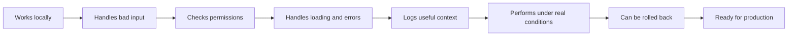

# From "It Works Locally" to Production: The Checklist Junior Developers Usually Miss


*A feature working on your machine is a good start. Production asks harder questions: users, permissions, retries, logs, performance, and rollback. Photo by Desola Lanre-Ologun on [Unsplash](https://unsplash.com/photos/black-hp-laptop-displaying-c-language-tWjzmNXKup4).*

There is a moment every developer knows.

The feature works on your laptop. The form submits. The page loads. The API returns data. You click around for a few minutes and think:

> Done.

Then it reaches real users.

Someone submits the form twice. Someone has a slow network. Someone is not allowed to access the record but changes the ID in the URL. Someone's payment succeeds but the success page does not load. Someone opens the dashboard on a low-end phone. Someone gets an error, but the logs do not show enough information to explain what happened.

The feature worked locally.

It was not ready for production.

That difference is one of the biggest gaps between junior and senior engineering.

Junior developers often ask:

> Does it work?

Senior developers ask:

> What happens when it fails?

That question changes how you build.

This article is a practical checklist for crossing that gap. Not a huge enterprise checklist. Not something that requires a 20-person platform team. Just the production habits that make a web feature safer, clearer, and easier to support.

## Local Success Is a Small Test

Local development is forgiving.

You usually have:

- one user
- clean test data
- fast internet
- no real attackers
- no impatient customers
- no queue delays
- no payment disputes
- no browser extensions
- no weird permissions
- no half-failed workflows

Production is different.

Production has real people, real money, real devices, real networks, real mistakes, and real business pressure.


*Production is not just your code running somewhere else. It is your code meeting real traffic, real failures, real devices, and real business pressure. Photo by Eric Stoynov on [Unsplash](https://unsplash.com/photos/two-server-racks-filled-with-electronic-components-and-wires-k27hkqXuveo).*

That is why "it works locally" is only the first checkpoint. It proves the happy path exists. It does not prove the feature is safe.



The goal is not to become paranoid.

The goal is to stop being surprised by normal production behavior.

## 1. The Feature Needs More Than the Happy Path

The happy path is what happens when everything goes right.

Example:

1. User fills the form.
2. User clicks submit.
3. API saves the record.
4. Page shows success.

That is important, but it is not enough.

A real feature also needs to handle:

- missing fields
- invalid emails
- expired sessions
- duplicate submissions
- slow requests
- failed requests
- users without permission
- empty results
- deleted records
- mobile screens
- browser refreshes

A junior developer may build the happy path and stop there.

A stronger developer asks, "What are the ways this can go wrong, and what should the user see when it does?"

For a simple form, that means the UI should not just have a submit button. It should have:

- disabled state while submitting
- validation messages
- error message if the request fails
- success message when it works
- protection against double submit
- server-side validation too

The frontend should make the experience nice.

The backend should make the rules real.

## 2. Do Not Trust the Frontend

The frontend can hide a button.

It cannot protect your system.

If a user should not delete a project, hiding the delete button is good UX. But the API must still check permission.

Bad pattern:

```ts
// The frontend hides this button from non-admins,
// so the backend assumes the request is safe.
await db.project.delete({
  where: { id: projectId },
});
```

Better pattern:

```ts
const project = await db.project.findFirst({
  where: {
    id: projectId,
    organizationId: currentUser.organizationId,
  },
});

if (!project || currentUser.role !== "admin") {
  return new Response("Forbidden", { status: 403 });
}

await db.project.delete({
  where: { id: project.id },
});
```

This matters because users can call APIs without your UI.

They can use browser devtools, scripts, copied requests, API clients, or changed URL parameters.

OWASP's API Security Top 10 lists Broken Object Level Authorization as a major API risk. In plain English, this happens when an API lets someone access or change an object they should not control.

Example:

```txt
/api/invoices/inv_123
```

If I change that to:

```txt
/api/invoices/inv_999
```

the server must check that `inv_999` belongs to me or my organization.

That is backend responsibility.

Not frontend responsibility.

## 3. Loading, Empty, and Error States Are Not Decoration

Some developers treat loading states like polish.

They are not polish.

They are part of the feature.

A dashboard that loads slowly without feedback feels broken. A table with no rows and no explanation feels broken. A form that fails silently feels broken.

A production-ready screen needs at least four states:

```txt
Loading
Loaded with data
Loaded with no data
Failed
```

Example:

```tsx
if (isLoading) {
  return <DashboardSkeleton />;
}

if (error) {
  return <ErrorMessage message="We could not load your dashboard." />;
}

if (projects.length === 0) {
  return <EmptyState message="No projects yet." />;
}

return <ProjectTable projects={projects} />;
```

That is not overengineering.

That is how real users experience software.

Founders feel this too. If a customer opens a blank screen and does not know whether the product is broken or empty, they lose confidence.

Good states reduce support tickets because the product explains itself at the moment of confusion.

## 4. Logs Should Help the Future You

Bad logs sound like this:

```txt
Something went wrong
```

That is almost useless.

Good logs answer the first questions you will ask during debugging:

- Which user?
- Which organization?
- Which route?
- Which request?
- Which record?
- Which external provider?
- What failed?

Example:

```ts
logger.error("Failed to create invoice", {
  requestId,
  userId: currentUser.id,
  organizationId: currentUser.organizationId,
  stripeCustomerId,
  error,
});
```

Do not log secrets, passwords, full card data, private tokens, or sensitive personal information.

But do log enough context to understand the failure.

Google's Site Reliability Engineering book talks about monitoring as collecting and displaying real-time data about a system. It also describes four useful signals for user-facing systems: latency, traffic, errors, and saturation.

For a small SaaS app, you do not need a huge observability stack on day one.

But you do need enough visibility to answer:

> Is the app broken, slow, overloaded, or failing for one customer?

If the answer is "we do not know," production will be stressful.

## 5. Performance Is Not Just a Lighthouse Score

A page can feel fast on your laptop and slow for users.

Maybe you are on a strong machine. Maybe your local data is tiny. Maybe your network is fast. Maybe production has more charts, more rows, more scripts, and more third-party tools.


*Performance problems rarely announce themselves during local testing. They show up when real users, real data, and real networks meet the feature. Photo by Stephen Dawson on [Unsplash](https://unsplash.com/photos/turned-on-monitoring-screen-qwtCeJ5cLYs).*

For web apps, Core Web Vitals are useful because they focus on real user experience. Google documents LCP, INP, and CLS as key metrics around loading, responsiveness, and visual stability.

In simpler language:

- **LCP** asks: how long until the main content appears?
- **INP** asks: how responsive is the page when the user interacts?
- **CLS** asks: does the layout jump around while loading?

But performance is not only frontend.

A slow dashboard may come from:

- one huge database query
- too many small database queries
- missing indexes
- server-rendering too much data
- loading every chart at once
- shipping too much JavaScript
- calling third-party APIs during page load
- no caching
- bad cache invalidation

A good production checklist includes basic performance questions:

- Does this page load with realistic data?
- What happens with 10 records? 1,000 records? 100,000 records?
- Are expensive queries indexed?
- Can slow sections load after the main content?
- Are we measuring real users, not only local dev?

Senior developers do not magically know why a page is slow.

They measure before guessing.

## 6. Configuration Should Not Be Hardcoded

Local apps often hide bad configuration habits.

This is risky:

```ts
const apiUrl = "https://api.example.com";
```

This is worse:

```ts
const stripeSecretKey = "sk_live_...";
```

Production apps need configuration that changes by environment:

- local
- preview
- staging
- production

The Twelve-Factor App describes backing services like databases, queues, caches, SMTP, and third-party APIs as attached resources. The app should connect to them through configuration, not hardcoded assumptions.

In practical terms:

```ts
const apiUrl = process.env.NEXT_PUBLIC_API_URL;
const stripeSecretKey = process.env.STRIPE_SECRET_KEY;
```

Then check the configuration at startup:

```ts
if (!process.env.STRIPE_SECRET_KEY) {
  throw new Error("Missing STRIPE_SECRET_KEY");
}
```

A missing environment variable should fail loudly during deploy.

It should not become a mysterious production bug three hours later.

## 7. External Services Will Fail

Your app probably depends on other services:

- Stripe
- Resend
- SendGrid
- Clerk
- Auth0
- Supabase
- OpenAI
- S3
- a CRM
- a payment provider
- a webhook from another app

If those services fail, timeout, or retry, your app needs a plan.

Bad pattern:

```ts
await sendWelcomeEmail(user.email);
await createUserAccount(user);
```

If the email provider fails, should account creation fail too?

Maybe yes.

Usually no.

Better pattern:

```ts
await createUserAccount(user);
await queueWelcomeEmail(user.id);
```

The email can be retried later. The account can still exist.

The production question is:

> Which parts must happen now, and which parts can happen later?

That one question prevents a lot of fragile systems.

## 8. Retries Need Guardrails

Retries sound simple.

If something fails, try again.

But retries can create duplicate work.

Imagine this:

```txt
User clicks "Upgrade"
Payment succeeds
Server times out
Frontend retries
Payment runs again
```

Now the user might be charged twice.

This is why payment flows, webhooks, and background jobs need idempotency. In plain English:

> Running the same action twice should not create two dangerous results.

For example, marking an order as paid should only work if the order is still pending:

```ts
const result = await db.order.updateMany({
  where: {
    id: orderId,
    status: "pending",
  },
  data: {
    status: "paid",
  },
});

if (result.count === 0) {
  return;
}

await activateSubscription(orderId);
```

That database condition matters.

It means the first successful worker moves the order forward. Any duplicate request sees that the order is no longer pending and stops.

This is the kind of detail that separates "the code works" from "the workflow is safe."

## 9. Every Feature Needs a Rollback Plan

A feature is not production-ready just because it can be deployed.

It also needs to be removable, disableable, or recoverable.

Before shipping, ask:

- Can we turn this off without another deploy?
- Can we roll back the database change?
- What happens to users who already used the feature?
- Is this behind a feature flag?
- Can we release it to one customer first?
- Do we know what metric would tell us it is broken?

For small teams, a rollback plan can be simple.

Example:

```ts
if (!flags.newBillingFlow) {
  return oldBillingFlow(req);
}

return newBillingFlow(req);
```

That is not fancy.

It is practical.

Founders care about this because bad releases interrupt sales, onboarding, support, and customer trust.

Senior developers care because they know every deploy is a bet. A rollback plan limits the size of the bet.

## 10. Production Readiness Is Mostly About Ownership

The checklist is not here to make development slower.

It is here to make ownership clearer.

When you ship a feature, you are not only shipping code. You are shipping a small promise:

> This will behave reasonably for real users, real data, real failures, and real business pressure.

That does not mean the feature must be perfect.

It means you thought past your laptop.

## The Checklist

Before calling a feature done, I would ask:

- Does it handle loading, empty, success, and error states?
- Does the backend validate the input?
- Does the backend check permissions?
- Can users access someone else's record by changing an ID?
- What happens if the user submits twice?
- What happens if the network is slow?
- What happens if an external service fails?
- Are logs useful without exposing secrets?
- Do we know how to measure errors and latency?
- Does it work with realistic data volume?
- Are expensive database queries indexed?
- Are secrets stored in environment variables?
- Is there a rollback or disable plan?
- Can support understand what happened if a customer reports a bug?

If you are a junior developer, this checklist will make your work stronger immediately.

If you are a senior developer, this is the kind of thinking you should teach during reviews.

And if you are a founder, this is what you want from engineers: not just people who can make a screen work, but people who can help the product survive contact with real users.

## Final Thought

"It works locally" is a good start.

It means the idea is alive.

But production asks harder questions.

Can the feature fail clearly? Can it recover? Can it protect customer data? Can it explain itself in the logs? Can the team turn it off if something goes wrong?

That is the real work.

Not because engineers enjoy making things complicated.

Because users do not experience your code on your laptop.

They experience it in the wild.

## Sources

- [Google SRE Book: Monitoring Distributed Systems](https://sre.google/sre-book/monitoring-distributed-systems/)
- [OWASP API Security Top 10 2023](https://owasp.org/API-Security/editions/2023/en/0x11-t10/)
- [web.dev: Core Web Vitals](https://web.dev/articles/vitals)
- [The Twelve-Factor App: Backing Services](https://12factor.net/backing-services)
