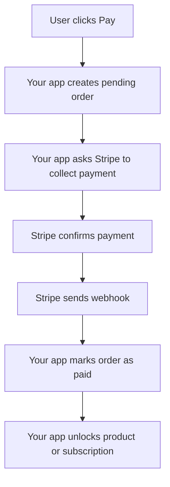
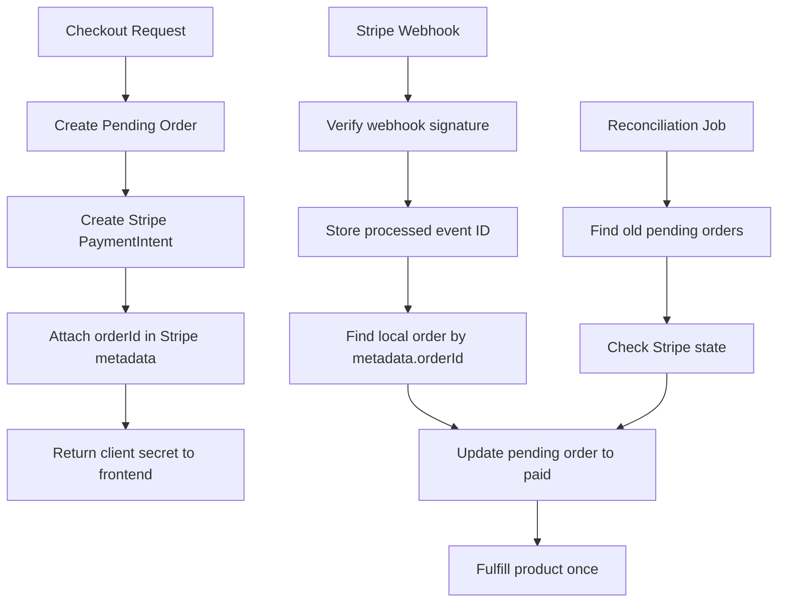

# Stripe Has Idempotency. Your App Still Needs It Too.

A user clicks **Pay**.

The button loads. The browser waits. The payment succeeds in Stripe. Then your server crashes before your database updates.

Now your app has an awkward problem.

Stripe knows the customer paid.

Your database still thinks the order is pending.

This is the kind of bug that makes payment systems feel simple during development and painful in production. The charge worked, but the product workflow did not finish.

That is the gap many developers miss.

Stripe can help you avoid duplicate payment requests. But Stripe cannot automatically finish your own app's work: creating the order, activating the subscription, adding credits, sending receipts, reducing inventory, updating invoices, or giving the user access.

That part is still your responsibility.

And if you are building a serious SaaS product, that responsibility matters.

## The Mistake: Thinking Stripe Solves the Whole Workflow

Stripe supports idempotency keys. That is real and useful.

An idempotency key lets you safely retry a Stripe API request without accidentally creating the same operation twice. Stripe's docs explain that when you send the same idempotency key again, Stripe can return the saved result of the first request instead of performing the operation again.

Example:

```ts
const paymentIntent = await stripe.paymentIntents.create(
  {
    amount: 5000,
    currency: "usd",
    customer: stripeCustomerId,
  },
  {
    idempotencyKey: checkoutAttemptId,
  }
);
```

That protects the Stripe request.

But your app usually has more work to do after Stripe succeeds.

```txt
Stripe payment succeeds
      |
      v
Create order
Mark invoice as paid
Activate subscription
Add user credits
Send receipt email
Notify internal systems
Update analytics
```

Stripe does not know your product rules.

It does not know whether you should unlock a course, upgrade a team, generate an invoice PDF, create a workspace, or add 100 AI credits to a user account.

That is why "Stripe already has idempotency" is only half the answer.

## The Real Problem: Payment Is Not One Step

A payment flow looks like one button to the user.

Behind the scenes, it is a small distributed system.



Every arrow can fail.

The browser can refresh. The network can timeout. Your server can crash. Stripe can retry a webhook. Your queue worker can run the same job twice. Your email provider can fail after the subscription was already activated.

The senior engineering question is not:

> Did the payment work?

The better question is:

> If any step runs twice, fails halfway, or retries later, does the customer still end up in the correct state?

That is where idempotency becomes an application design problem, not just a Stripe feature.

## A Common Broken Flow

A simple checkout endpoint might look like this:

```ts
export async function POST(req: Request) {
  const { userId, productId } = await req.json();

  const paymentIntent = await stripe.paymentIntents.create({
    amount: 5000,
    currency: "usd",
    customer: await getStripeCustomerId(userId),
  });

  await db.order.create({
    data: {
      userId,
      productId,
      stripePaymentIntentId: paymentIntent.id,
      status: "paid",
    },
  });

  await sendReceiptEmail(userId);

  return Response.json({ success: true });
}
```

This looks fine until production happens.

What if Stripe creates the payment intent, but your database write fails?

What if the request times out and the frontend retries?

What if the email sends, but the response fails?

What if the user double-clicks?

What if two tabs submit the same checkout?

What if the webhook also tries to mark the same order as paid?

Now you are not just debugging code. You are debugging money.

## The Better Pattern: Create the Local Order First

A safer design starts by creating your own local record before asking Stripe to collect money.

```ts
const order = await db.order.create({
  data: {
    userId,
    productId,
    amount: 5000,
    currency: "usd",
    status: "pending",
  },
});
```

Then you create the Stripe payment and attach your order ID as metadata.

```ts
const paymentIntent = await stripe.paymentIntents.create(
  {
    amount: order.amount,
    currency: order.currency,
    customer: stripeCustomerId,
    metadata: {
      orderId: order.id,
      userId,
    },
  },
  {
    idempotencyKey: `checkout:${order.id}`,
  }
);
```

Now Stripe and your database have a shared reference: `order.id`.

That gives you a recovery path.

If your server crashes after Stripe succeeds, the webhook can still find the order later.

If support needs to investigate, the Stripe object points back to your system.

If reconciliation runs overnight, your app can compare Stripe state against local order state.

This is much better than trying to guess what happened from a customer ID alone.

## Webhooks Are Not Optional Glue

In a serious payment flow, the webhook should be the place where your app reacts to confirmed Stripe events.

The frontend should not be your source of truth.

A browser redirect can fail. A tab can close. A mobile connection can drop. A user can pay and never reach your success page.

Stripe's webhook system exists because payment confirmation often happens asynchronously.

A simplified webhook might look like this:

```ts
export async function handlePaymentSucceeded(event: Stripe.Event) {
  const paymentIntent = event.data.object as Stripe.PaymentIntent;
  const orderId = paymentIntent.metadata.orderId;

  const order = await db.order.findUnique({
    where: { id: orderId },
  });

  if (!order) {
    throw new Error(`Order not found: ${orderId}`);
  }

  if (order.status === "paid") {
    return;
  }

  await db.order.update({
    where: { id: order.id },
    data: {
      status: "paid",
      stripePaymentIntentId: paymentIntent.id,
      paidAt: new Date(),
    },
  });

  await activateProduct(order.userId, order.productId);
}
```

That `if (order.status === "paid") return;` is doing important work.

It protects your app from processing the same payment twice.

## But That Check Is Still Not Enough

This code has a race condition:

```ts
if (order.status === "paid") {
  return;
}

await db.order.update({
  where: { id: order.id },
  data: { status: "paid" },
});

await activateProduct(order.userId, order.productId);
```

Two webhook handlers could read the order at the same time.

Both see `pending`.

Both update it.

Both activate the product.

A safer pattern is to update only if the order is still pending:

```ts
const result = await db.order.updateMany({
  where: {
    id: orderId,
    status: "pending",
  },
  data: {
    status: "paid",
    paidAt: new Date(),
  },
});

if (result.count === 0) {
  return;
}

await activateProduct(order.userId, order.productId);
```

Now the database helps you enforce the rule:

> Only the first worker that changes the order from pending to paid gets to continue.

That is the real idempotency pattern.

Not "hope this code only runs once."

More like:

> Design the workflow so running it twice still produces one correct result.

## Founders Feel This as Support Pain

Payment bugs are not abstract engineering problems.

Founders usually feel them through support tickets.

A customer says:

> I paid, but my account is still on the free plan.

Another says:

> I was charged twice.

Another says:

> The invoice says paid, but your app says overdue.

Another says:

> I upgraded yesterday. Why did my team lose access?

These are trust-damaging bugs because they touch money and access.

Even worse, they create manual work:

- checking Stripe manually
- refunding duplicate charges
- editing database records
- apologizing to customers
- explaining the issue to sales
- creating one-off scripts
- trying to reconstruct what happened from logs

A clean payment workflow saves engineering time, but it also protects customer trust.

## Use a State Machine, Even a Simple One

You do not need a fancy library to start thinking in states.

An order should move through clear states:

```txt
pending -> paid -> fulfilled
pending -> failed
paid -> refunded
paid -> disputed
```

That is already better than a random boolean like this:

```ts
isPaid: true
```

A boolean cannot explain much.

Was payment attempted? Did it fail? Was it refunded? Did fulfillment happen? Was the order cancelled? Is the invoice overdue?

A state tells a clearer story.

```ts
type OrderStatus =
  | "pending"
  | "paid"
  | "fulfilled"
  | "failed"
  | "refunded";
```

Then your code can enforce valid transitions:

```ts
function canMarkPaid(status: OrderStatus) {
  return status === "pending";
}
```

For a small SaaS, this may feel like extra work.

But once billing issues start coming in, clear states become one of the best debugging tools you have.

## Store Processed Webhook Events

Stripe's docs say webhook endpoints may receive the same event more than once, and they recommend logging processed event IDs so you do not process duplicates again.

That can be as simple as a table:

```sql
CREATE TABLE stripe_webhook_events (
  id TEXT PRIMARY KEY,
  type TEXT NOT NULL,
  processed_at TIMESTAMP NOT NULL DEFAULT now()
);
```

Then in your webhook handler:

```ts
try {
  await db.stripeWebhookEvent.create({
    data: {
      id: event.id,
      type: event.type,
    },
  });
} catch {
  return;
}
```

If the event ID already exists, this event has already been handled.

This is useful, but do not rely on event ID alone for every business rule. Stripe also notes that in some cases separate event objects can represent the same underlying object change. For that, you may need to deduplicate using the Stripe object ID plus the event type.

For example:

```txt
payment_intent.succeeded + pi_123
```

The goal is simple:

> A webhook can arrive twice, but your product should not fulfill twice.

## Reconciliation: The Safety Net

Even with good webhooks, you still want a way to repair drift.

Reconciliation means comparing your local database with Stripe and fixing mismatches.

Example:

```txt
Stripe says invoice is paid
Your database says invoice is pending
```

That mismatch can happen if:

- your webhook endpoint was down
- a deployment broke processing
- a database transaction failed
- an event was delayed
- a queue worker crashed
- someone changed data manually

A reconciliation job might run every hour or every night:

```ts
const pendingOrders = await db.order.findMany({
  where: {
    status: "pending",
    createdAt: { lt: oneHourAgo },
  },
});

for (const order of pendingOrders) {
  const paymentIntent = await stripe.paymentIntents.retrieve(
    order.stripePaymentIntentId
  );

  if (paymentIntent.status === "succeeded") {
    await markOrderPaid(order.id, paymentIntent.id);
  }
}
```

This is the part that makes the "just check Stripe later" idea correct.

Yes, you can check Stripe later.

But the clean version is not "search by customer and guess." The clean version is:

- create a local order
- attach the order ID to Stripe metadata
- process webhooks idempotently
- run reconciliation when state drifts

That gives you a system that can recover.

## A Practical Architecture



This design has three important properties:

- Stripe protects the Stripe operation with idempotency keys.
- Your database protects your product workflow with state transitions.
- Reconciliation protects you when events or servers fail.

That is the difference between "I integrated Stripe" and "I designed a payment workflow."

## The Checklist I Would Use Before Shipping

Before shipping a payment flow, I would ask:

- Do we create a local pending order before payment confirmation?
- Does the Stripe object include our local `orderId` in metadata?
- Are Stripe API calls using idempotency keys where retries are possible?
- Can the webhook safely receive the same event twice?
- Do we store processed webhook event IDs?
- Does fulfillment only happen once?
- Do database updates check the current state before changing it?
- Can we recover if Stripe succeeds but our server crashes?
- Do we have a reconciliation job for stuck pending orders?
- Can support trace one payment from our database to Stripe and back?
- Are receipt emails, credits, and subscription activation also duplicate-safe?

If the answer is no, the payment flow might work during a demo, but it is not ready for real users.

## The Real Lesson

Stripe gives you strong tools.

But Stripe is not your application state machine.

It can tell you a payment succeeded. It can retry webhooks. It can help prevent duplicate API operations with idempotency keys.

But your app still owns the product outcome.

Your app decides whether an order is paid, whether a subscription is active, whether credits were added, whether a receipt was sent, and whether the customer got what they paid for.

So the mature way to think about payments is not:

> Stripe handled it.

It is:

> Stripe handled the payment. My app still has to handle the workflow.

That is where reliable SaaS engineering begins.

## Sources

- [Stripe API Reference: Idempotent requests](https://docs.stripe.com/api/idempotent_requests)
- [Stripe Docs: Receive Stripe events in your webhook endpoint](https://docs.stripe.com/webhooks)
- [Stripe Docs: Handle duplicate events](https://docs.stripe.com/webhooks#handle-duplicate-events)
- [Stripe API Reference: Metadata](https://docs.stripe.com/api/metadata)
